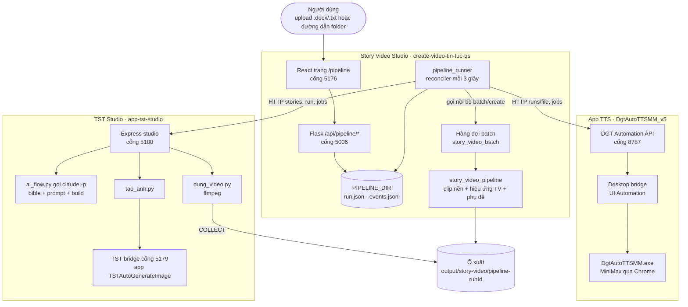
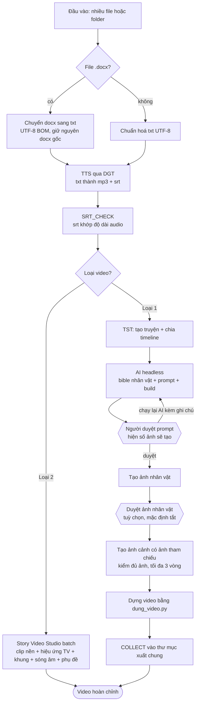
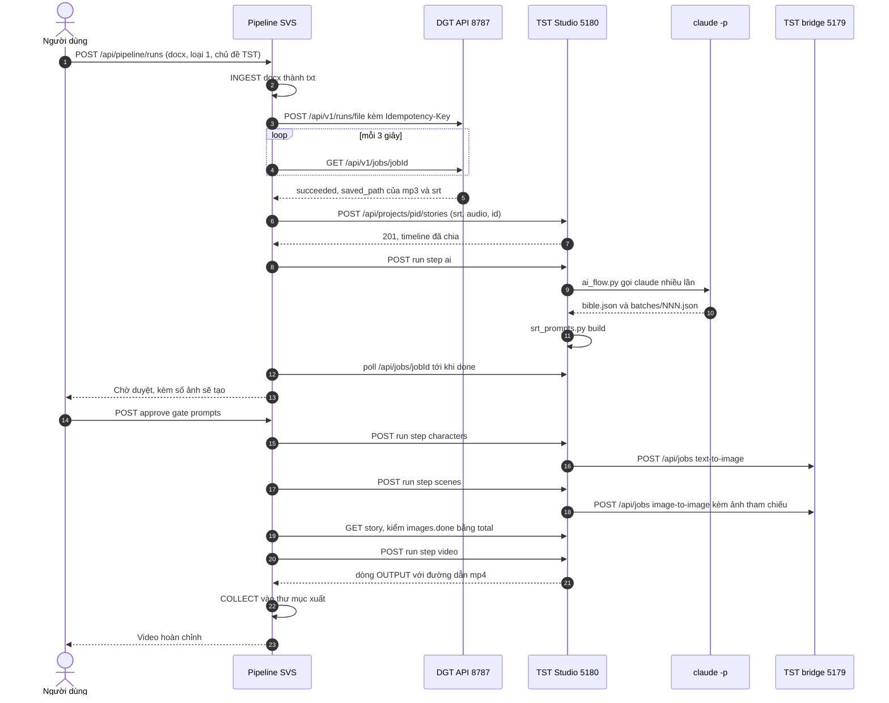
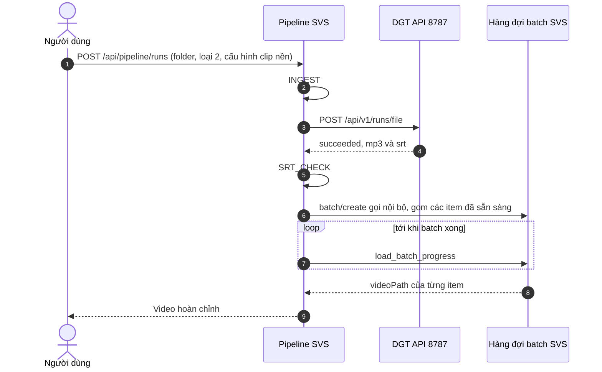
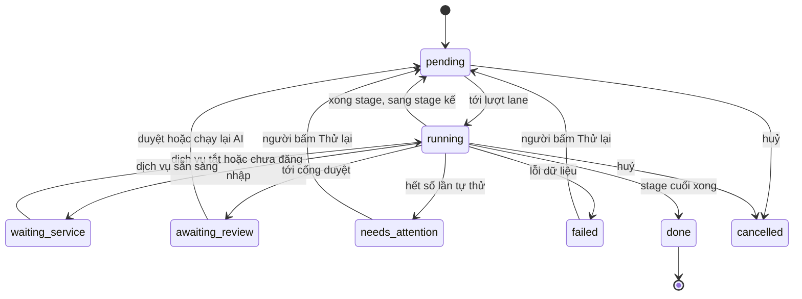

# Tích hợp 3 app: kịch bản → video hoàn chỉnh

> Bộ tài liệu cho bản cập nhật lớn: gộp **app TTS**, **app tạo ảnh (TST Studio)** và **app dựng video nền (Story Video Studio)** thành một luồng tự động.
> Trạng thái: **đã tích hợp code P1–P5 trên nhánh `develop`** (14/10/2026). Chưa chạy với app TTS thật, `claude -p` thật và tạo ảnh TST thật. Xem [05 · Trạng thái](05-ke-hoach-trien-khai.md#trạng-thái-cập-nhật-14102026).
> Sơ đồ viết bằng Mermaid. Xem trong VS Code bằng Markdown Preview (cần extension hỗ trợ Mermaid) hoặc trên GitHub/GitLab.

## Mục lục (đọc theo thứ tự)

| # | Tài liệu | Nội dung |
|---|---|---|
| 00 | **Tổng quan kiến trúc** (file này) | 3 app, sơ đồ cấu trúc, sơ đồ luồng, trạng thái, cổng, điều kiện vận hành |
| 01 | [App TTS: DgtAutoTTSMM + Automation API](01-app-tts-dgt.md) | Toàn bộ API `:8787`, cách chia đoạn và sinh SRT, cách lấy file, DocxToTxt.ps1 |
| 02 | [App tạo ảnh: TST Studio + TST bridge + skills](02-app-tst-studio.md) | API `:5180` và `:5179`, `flow.py`, hợp đồng file, `tao_anh`, `dung_video`, lỗi đã biết |
| 03 | [App dựng video nền: Story Video Studio](03-app-story-video-studio.md) | Toàn bộ API `:5006`, công thức batch, pipeline render, cấu hình, bẫy |
| 04 | [Thiết kế pipeline](04-thiet-ke-pipeline.md) | Mô hình dữ liệu, stage machine, bước AI headless, cổng duyệt, API `/api/pipeline/*`, UI |
| 05 | [Kế hoạch triển khai](05-ke-hoach-trien-khai.md) | Phase P0-P5, file sửa ở từng repo, tiêu chí nghiệm thu, kiểm thử, rủi ro |

---

## 1. Bài toán

**Hai luồng hiện có, chạy rời từng bước bằng tay:**
- **Loại 1 (ảnh minh hoạ):** kịch bản → audio + srt → tạo ảnh từ srt → dựng video.
- **Loại 2 (clip nền):** kịch bản → audio + srt → ghép video nền, hiệu ứng, chỉnh sửa → video.

**Mục tiêu:** một luồng chạy tự động từ đầu đến cuối.
- **Đầu vào:** nhiều file upload, hoặc một đường dẫn folder chứa `.docx` / `.txt`. Docx tự chuyển sang txt.
- **Loại 1:** có thêm bước **AI agent chuyển SRT thành danh sách prompt, người xác nhận** trước khi tạo ảnh.

**Quyết định kiến trúc:**

| Chủ đề | Quyết định |
|---|---|
| Orchestrator | Nằm **trong Story Video Studio**, vì app này đã có luồng loại 2, hàng đợi lưu file và frontend |
| AI agent | **Claude Code CLI headless** (`claude -p`), dùng lại skill `srt-prompt-anh` + bộ skill của chủ đề (skill vẽ chính + skill thêm), chạy bằng script `ai_flow.py` trong TST Studio |
| Cổng duyệt | Duyệt prompt **bắt buộc**; duyệt ảnh nhân vật **tuỳ chọn, mặc định tắt** |
| App TTS | Không sửa; gọi qua Automation API có sẵn |
| Tài liệu | Gom tại `create-video-tin-tuc-qs/docs/integration/` |

## 2. Ba app

| | App TTS | App tạo ảnh | App dựng video nền (host) |
|---|---|---|---|
| Thư mục | `C:\Users\hiv\Documents\Cua Dung\app-tts-dgt` | `C:\Users\hiv\Documents\Cua Dung\app-tst-studio` | `C:\Users\hiv\Documents\Cua Dung\create-video-tin-tuc-qs` |
| Công nghệ | EXE WinForms của nhà cung cấp + API .NET 10 tự viết | Express + React, Python skills, bridge C# | Flask + FFmpeg, React + Vite |
| Cổng | API `127.0.0.1:8787` | Studio `127.0.0.1:5180`, bridge `127.0.0.1:5179` | Flask `127.0.0.1:5006`, Vite `5176` |
| Khởi động | `scripts\Start-Api.ps1` (cùng quyền admin với EXE) | `start-studio.cmd`; app TST qua `tst-bridge\start-with-api.ps1` | `npm run dev` (gốc repo) |
| Vai trò | txt → mp3 + srt | srt → timeline → bible / prompt → ảnh → video | **Orchestrator** + render loại 2 |
| Làm tay bắt buộc | Mở `DgtAutoTTSMM.exe` (1 cửa sổ, để rảnh), đăng nhập MiniMax / license, cùng mức quyền, phiên desktop tương tác | Đăng nhập license TST | Không (Mongo chỉ cần với chế độ clip `once`) |
| Chi tiết | [01](01-app-tts-dgt.md) | [02](02-app-tst-studio.md) | [03](03-app-story-video-studio.md) |

## 3. Sơ đồ cấu trúc



## 4. Sơ đồ luồng tổng



**Stage theo từng loại:**

```
Loại 1: INGEST → TTS → SRT_CHECK → TST_STORY → AI → BUILD → ⏸GATE_PROMPTS → CHARACTERS
        → [⏸GATE_CHARACTERS] → SCENES → VIDEO → COLLECT → DONE
Loại 2: INGEST → TTS → SRT_CHECK → SV_RENDER → DONE
```

## 5. Sơ đồ tuần tự: loại 1



## 6. Sơ đồ tuần tự: loại 2



## 7. Trạng thái của một item



Chi tiết từng trạng thái xem [04 §4](04-thiet-ke-pipeline.md#4-stage-machine).

## 8. Chạy song song (lane)

Các item chạy gối nhau. Ví dụ: item 2 đang TTS trong khi item 1 đang tạo ảnh, và item 3 (loại 2) đang render.

| Lane | Giới hạn | Lý do |
|---|---|---|
| TTS | 1 file một lúc (do DGT, FIFO toàn hệ thống) | DGT điều khiển một cửa sổ desktop |
| AI | 1 | Rate limit của gói Claude |
| Ảnh TST | 1 truyện một lúc, chờ thêm nếu có job tạo ảnh chạy tay | Hàng đợi TST dùng chung, tốc độ 3-5 ảnh/phút |
| Render loại 1 | 1 | `dung_video` dùng 6 worker ffmpeg |
| Render loại 2 | 1 batch một lúc, `STORY_BATCH_MAX_WORKERS` video song song trong batch | Hàng đợi có sẵn của SVS; pipeline gom item thành micro-batch |

## 9. Cổng và biến môi trường

| Dịch vụ | Địa chỉ | Biến cấu hình phía pipeline |
|---|---|---|
| Pipeline / SVS | `http://127.0.0.1:5006` (UI dev `:5176`) | `WEB_HOST`, `WEB_PORT`, `PIPELINE_DIR` |
| DGT Automation API | `http://127.0.0.1:8787` | `DGT_API_URL` |
| TST Studio | `http://127.0.0.1:5180` | `TST_STUDIO_URL` |
| TST bridge | `http://127.0.0.1:5179/api` | (chỉ TST Studio gọi: `TST_API`, `TST_API_KEY`) |
| Claude CLI | tiến trình con của TST Studio | `CLAUDE_BIN`, `AI_MODEL`, `AI_TIMEOUT` (env của TST Studio) |
| MongoDB (tuỳ chọn) | `127.0.0.1:27017` | `MONGODB_URI` |

Danh sách đầy đủ biến mới: [04 §14](04-thiet-ke-pipeline.md#14-cấu-hình-mới).

## 10. Checklist trước khi chạy pipeline

**Cách nhanh (16/10/2026):** `npm run dev` ở gốc `create-video-tin-tuc-qs` làm bước 1–3 dưới đây: bật SVS, mở app DGT + API (hỏi UAC một lần) và app TST + TST Studio nếu chưa chạy. Bạn chỉ còn đăng nhập app DGT / license TST, rồi làm bước 4. Ctrl+C chỉ tắt SVS; API DGT và TST Studio chạy nền (log `logs/services/`), tắt bằng `npm run dev:stop`. Chi tiết: README §7 "Dev".

Cách tay:

1. **DGT:**
   - mở `DgtAutoTTSMM.exe` (1 cửa sổ), đăng nhập, không mở hộp thoại nào;
   - chạy `scripts\Start-Api.ps1` **cùng mức quyền admin** với EXE;
   - kiểm tra `GET :8787/api/v1/runtime`.
2. **TST** (chỉ khi có item loại 1):
   - mở app TST bằng `tst-bridge\start-with-api.ps1` và **bấm đăng nhập license**;
   - chạy `start-studio.cmd`;
   - kiểm tra `claude` (`GET :5180/api/ai`).
3. **SVS:** `npm run dev` ở gốc `create-video-tin-tuc-qs`. Bật Mongo nếu dùng chế độ clip `once`.
4. Mở `http://127.0.0.1:5176/pipeline`: panel dịch vụ phải xanh với các loại sẽ chạy.

Pipeline **không tự bật/tắt** app nào và không tự đăng nhập. Dịch vụ thiếu thì item chuyển `waiting_service` và tự chạy tiếp khi dịch vụ sẵn sàng.
