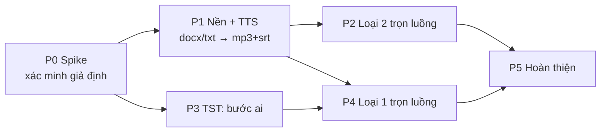

# 05. Kế hoạch triển khai

> Thiết kế chi tiết ở [04](04-thiet-ke-pipeline.md). Tài liệu này chia việc thành các phase. Mỗi phase có danh sách file và tiêu chí nghiệm thu.
> Cỡ việc: **S** ≤ nửa ngày · **M** 1-2 ngày · **L** 3-5 ngày.

[← 04 Thiết kế pipeline](04-thiet-ke-pipeline.md) · [Tổng quan](00-tong-quan-kien-truc.md)

## Trạng thái (cập nhật 14/10/2026)

| Phase | Trạng thái | Commit |
|---|---|---|
| P0 | Spike 0.4 xong; các spike còn lại **chờ người dùng cho phép** (tốn lượt Claude / MiniMax / license TST) | — |
| P1 | Xong | SVS `develop` 7b20a7c |
| P2 | Xong (+ `outputSubdir` cho `batch/create`) | SVS 4fe6678 |
| P3 | Xong | TST `develop` 0c957fd |
| P4 | Xong | SVS cf4832e |
| P5 | Xong: preset, chạy lại từ bước bất kỳ, cảnh báo dung lượng, link Google Docs, sửa `retry-failed`, số việc cần xử lý trên tab trình duyệt. Còn lại: tách route `batch/create` thành service | SVS (commit P5) |

**Đã kiểm thử:**
- Toàn bộ test cũ của SVS giữ nguyên kết quả (7 test vốn đã lỗi trước khi tích hợp, không phát sinh lỗi mới).
- Test mới: pytest SVS `tests/test_pipeline_*.py`; unittest TST `.claude/skills/srt-flow/tests`.
- Chạy thật trên máy với app TTS giả (`fake_dgt.py`, sinh mp3 bằng ffmpeg):
  - **loại 2 render thật** ra mp4 1080p có clip nền, sóng âm, CTA, phụ đề;
  - **loại 1** chạy qua TST Studio thật (cổng thử 5199) với claude giả, tới bước duyệt prompt; "Chạy lại AI" có ghi chú hoạt động.
- **Chưa chạy với app TTS thật, `claude -p` thật và tạo ảnh TST thật** (xem các spike P0).

**Biến môi trường mới** (SVS): `PIPELINE_DIR`, `DGT_API_URL`, `TST_STUDIO_URL`, `PIPELINE_*` ([04 §14](04-thiet-ke-pipeline.md#14-cấu-hình-mới)), `DGT_WORK_DIR`, `PIPELINE_DISK_WARN_GB`, `PIPELINE_MIN_FREE_GB`.
**TST Studio:** `CLAUDE_BIN`, `AI_MODEL`, `AI_TIMEOUT`.

---

## Tổng quan các phase

| Phase | Kết quả có thể dùng ngay | Repo bị sửa | Cỡ |
|---|---|---|---|
| P0 | Ghi nhận kết quả thử nghiệm vào tài liệu này | Không sửa code | S |
| P1 | Thả folder kịch bản vào, nhận mp3 + srt | SVS | L |
| P2 | Kịch bản → video loại 2 tự động hoàn toàn | SVS | M |
| P3 | Nút "Chạy AI" trong TST Studio (dùng độc lập được) | TST | M |
| P4 | Kịch bản → video loại 1, dừng 1 lần để duyệt prompt | SVS (+TST nhỏ) | L |
| P5 | Preset, nhật ký, thông báo, tách service, dọn đĩa | SVS, TST | M |

P2 và P3 làm song song được.

---

## P0. Spike: xác minh giả định (chưa viết code sản phẩm)

| # | Thử nghiệm | Cách làm | Ghi kết quả |
|---|---|---|---|
| 0.1 | `claude -p` headless ghi `bible.json` cho một truyện mẫu | Tạo truyện thử trong chủ đề `truyen-ma` (chưa có truyện). Chạy lệnh ở [04 §7.3](04-thiet-ke-pipeline.md#73-lệnh-claude) với file nhiệm vụ viết tay. | Cờ nào chạy được; thời gian; có ghi ra ngoài `_anh/` không; có hỏi quyền không; mức dùng quota |
| 0.2 | Vòng prompt: 4 batch (140 đoạn) trong 1 lần gọi | Như trên, `next=prompts` | Tốc độ; chất lượng; số lỗi build |
| 0.3 | DGT chia đoạn khi có / không có dòng trống giữa đoạn | Cùng một docx, 2 bản txt, giọng ngắn | Số cue, độ dài cue, chất lượng nhịp đọc → chọn mặc định cho `blankLineBetweenParagraphs` |
| 0.4 | Python `docx_to_text` so với `DocxToTxt.ps1` | 5 docx thật (có text box, tab, ngắt trang, list) | Khớp byte-for-byte? Ghi lại sai khác |
| 0.5 | 2 tiến trình `tao_anh` chạy song song trên TST bridge | Hai truyện nhỏ | Có xung đột? Quyết định giữ lane ảnh = 1 |
| 0.6 | Giới hạn phiên NVENC khi SVS (3 worker) và `dung_video` (6 worker) chạy cùng lúc | Render đồng thời | Có lỗi `OpenEncodeSessionEx`? → giá trị mặc định cho `PIPELINE_RENDER_EXCLUSIVE` |

> ⚠️ Mục 0.1, 0.2, 0.3 và 0.5 **tốn lượt** (Claude, MiniMax, license TST). Hỏi người dùng trước khi chạy và nói rõ số lượt.

**Nghiệm thu:** bảng kết quả được ghi vào cuối tài liệu này; các quyết định mặc định được cập nhật vào [04](04-thiet-ke-pipeline.md).

---

## P1. Nền tảng pipeline + TTS (SVS)

**Phạm vi:** `INGEST → TTS → SRT_CHECK`, cho cả hai loại; loại 1 và 2 tạm dừng ở `SRT_CHECK` xong.

| Việc | File |
|---|---|
| Biến cấu hình mới ([04 §14](04-thiet-ke-pipeline.md#14-cấu-hình-mới)) | sửa `src/config.py` (repo chưa có `.env.example`; ghi các biến vào README pipeline) |
| Lưu trữ run (atomic, khoá, events) | mới `src/utils/pipeline_store.py` |
| Quét folder, upload, docx → txt, chuẩn hoá txt, slug | mới `src/utils/pipeline_ingest.py` |
| `DgtClient` (health, runtime, voices, runs/file, jobs, cancel) | mới `src/utils/pipeline_clients.py` |
| Reconciler + handler `TTS`, `SRT_CHECK` + `resume_pipeline_runs()` | mới `src/utils/pipeline_runner.py` |
| Blueprint `/api/pipeline`: health, scan, runs CRUD, events, pause / resume / cancel, retry / cancel item, `tts/voices` | mới `src/routes/pipeline_routes.py`; đăng ký ở `src/web_app.py:21-24`; resume ở `src/web_app.py:99-105` và `wsgi.py` |
| Trang Pipeline bản tối thiểu: panel dịch vụ, form đầu vào, bảng item | mới `frontend/src/pages/PipelinePage.tsx`, `components/pipeline-*`; sửa `router.tsx` (thêm trước L27-30), `components/top-nav.tsx`, `lib/api.ts`, `types/api.ts` |
| Test | mới `tests/test_pipeline_ingest.py` (+ `tests/fixtures/pipeline/*.docx` và txt chuẩn sinh bằng PS1), `tests/test_pipeline_store.py`, `tests/test_pipeline_runner.py` (DgtClient giả; monkeypatch `Config.*_DIR` → `tmp_path` như `tests/test_story_video_batch_queue.py:34-49`) |

**Nghiệm thu:**
- [ ] Folder có 3 file (2 docx, 1 txt) cho ra 3 bộ `txt + mp3 + srt` trong `runs/<id>/items/*/`.
- [ ] **Docx gốc còn nguyên**; thư mục của người dùng không có file mới.
- [ ] Golden test docx → txt khớp với `DocxToTxt.ps1`.
- [ ] Restart SVS trong lúc đang TTS **không sinh job DGT trùng** (kiểm `GET :8787/api/v1/queue`).
- [ ] Tắt DGT EXE: item chuyển `waiting_service` với lý do rõ ràng; mở lại thì tự chạy tiếp.
- [ ] Tên file tiếng Thái hoặc Nhật cho slug `item-NN`, vẫn chạy được.
- [ ] `pytest` xanh, kể cả các test cũ.

---

## P2. Loại 2 trọn luồng (SVS)

| Việc | File |
|---|---|
| Sửa nhánh đọc JSON của `batch/create`: dùng `request.get_json` khi không có `payload` form | sửa `src/routes/story_video_routes.py:3209-3213` |
| `batch/create` nhận `sharedConfig.outputSubdir` (chỉ `[A-Za-z0-9_-]`) và truyền `output_subdir` cho `StoryVideoBatchRunner` | sửa `story_video_routes.py:3471-3473` |
| `submit_story_batch()` qua `app.test_client()`, theo dõi bằng `load_batch_progress`, micro-batch, gửi lại 1 lần khi lỗi, khôi phục bằng quét batch | mới `src/utils/pipeline_sv.py`; handler `SV_RENDER` trong `pipeline_runner.py` |
| Form cấu hình loại 2 rút gọn (thư viện, preset phụ đề, font, style TV, ổ xuất), bắt buộc chọn thư viện | `components/pipeline-type2-config.tsx` |
| Cảnh báo health: `RENDER_SUSPEND_PROCESS_NAMES`, hết decor | `pipeline_routes.py` |
| Test | `tests/test_pipeline_sv.py` (test_client với runner giả) + test cho 2 sửa đổi ở route |

**Nghiệm thu:**
- [ ] 3 kịch bản loại 2 cho ra 3 mp4 có phụ đề trong `<ổ>/output/story-video/pipeline-<runId>/`.
- [ ] Các item về gần nhau được gom vào cùng một batch và render song song theo `STORY_BATCH_MAX_WORKERS`.
- [ ] Batch của pipeline vẫn hiện trên trang `/story-video` như batch thường.
- [ ] Gửi JSON thẳng vào `batch/create` giờ hoạt động; client multipart cũ không bị ảnh hưởng.
- [ ] Batch luôn chạy với `optimizeMode=false`.

---

## P3. TST Studio: bước "ai" (repo TST)

| Việc | File |
|---|---|
| Script vòng lặp AI ([04 §7.2](04-thiet-ke-pipeline.md#72-ai_flowpy)), chỉ dùng stdlib | mới `.claude/skills/srt-flow/scripts/ai_flow.py` |
| Mẫu file nhiệm vụ (bible / prompts / fix) | mới `.claude/skills/srt-flow/references/ai-headless-prompt.md` |
| `STEPS.ai`, điều kiện chặn (không đòi `prompts.json`), `note` → `--ghi-chu` | sửa `studio/server/index.js:191-247`, thêm hằng `AI_FLOW` trong `lib.js` |
| `GET /api/ai`, `POST …/ai/reset` | sửa `studio/server/index.js` |
| Sửa `uniqueStoryId` (slug rỗng sinh `-2`) | sửa `studio/server/lib.js:354-358` |
| Nút "Chạy AI" + tiến độ ở trang truyện; `steps.tsx` hiện trạng thái | sửa `studio/src/components/Pipeline.tsx`, `studio/src/components/steps.tsx`, `studio/src/api.ts` |
| Cập nhật tài liệu TST | sửa `docs/02-Ke-hoach-luong-SRT-anh.md` (mục P5), `docs/03-Tich-hop-OpenAPI.md`, `docs/openapi/tst-studio.openapi.yaml`, `CLAUDE.md` (thêm quy tắc chạy AI headless) |

**Nghiệm thu:**
- [ ] Trên một truyện mới, `POST /run {step:"ai"}` cho ra `bible.json` và đủ `batches/`, `build` qua, `flow.next == "characters"`.
- [ ] Chỉ có file trong `_anh/` thay đổi; `segments.json` giữ nguyên mtime.
- [ ] Huỷ job thì kill được claude (`taskkill /T`); chạy lại thì tiếp từ batch kế tiếp.
- [ ] Không tìm thấy claude: job lỗi với thông báo rõ ràng (exit 4); `GET /api/ai` trả `found:false`.
- [ ] Tải truyện có tên file tiếng Thái lên thì có id hợp lệ.

---

## P4. Loại 1 trọn luồng (SVS)

| Việc | File |
|---|---|
| `TstClient`: tst, projects, story get / create, run, jobs, ai, reset | sửa `src/utils/pipeline_clients.py` |
| Handler `TST_STORY`, `AI`, `BUILD`, `GATE_*`, `CHARACTERS`, `SCENES`, `VIDEO`, `COLLECT`; lane; gắn vào job đang chạy; suy lại trạng thái khi TST restart | sửa `src/utils/pipeline_runner.py` |
| API review / approve / reject, `tst/projects` | sửa `src/routes/pipeline_routes.py` |
| Hộp thoại duyệt (nhân vật + bảng prompt + cảnh báo + chạy lại AI) | mới `components/pipeline-review-dialog.tsx` |
| Form loại 1 (chủ đề TST, ngôn ngữ, cổng duyệt ảnh nhân vật) | `components/pipeline-type1-config.tsx` |
| Test | `tests/test_pipeline_type1.py` (TstClient giả mô phỏng flow status) |

**Nghiệm thu:**
- [ ] Một kịch bản loại 1 chạy tới `GATE_PROMPTS`, **không có ảnh nào được tạo trước khi bấm Duyệt**.
- [ ] Sau khi duyệt, chạy hết tới video. `images.done == total` được kiểm; thiếu ảnh thì tự chạy lại vòng.
- [ ] Bật cổng duyệt ảnh nhân vật thì dừng đúng sau `CHARACTERS`.
- [ ] "Chạy lại AI" kèm ghi chú: bible và batch được viết lại, `segments.json` giữ nguyên.
- [ ] Restart TST Studio trong lúc `SCENES`: pipeline phát hiện job mất, chạy lại `scenes`, không trùng ảnh.
- [ ] TST chưa đăng nhập: `waiting_service` (`tst:not_logged_in`); đăng nhập xong thì tự chạy tiếp.
- [ ] Video loại 1 có mặt trong thư mục xuất chung (hardlink nếu cùng ổ).

---

## P5. Hoàn thiện

| Việc | Repo |
|---|---|
| Nút "Lưu cấu hình cho Pipeline" ở `StoryVideoPage.tsx` → preset `PIPELINE_DIR/presets/*.json`; form pipeline chọn preset | SVS |
| Trang xem `events.jsonl` của item, lọc theo stage | SVS |
| Thông báo khi item cần duyệt hoặc cần xử lý (toast trên trang + tiêu đề tab) | SVS |
| Retry từ stage bất kỳ (`fromStage`) | SVS |
| Tách route `batch/create` thành hàm service không phụ thuộc Flask; pipeline tự cấp `batchId` | SVS |
| Sửa `retry-failed` làm mất `tvEffectStyleId` | SVS |
| Cảnh báo dung lượng: DGT `desktop-work` (13 GB), cache `_video/_cache` của TST | SVS (health) |
| Hỗ trợ đầu vào Google Docs link → txt (dùng lại `tts_audio` export) | SVS |

---

## Kế hoạch kiểm thử

| Mức | Nội dung |
|---|---|
| Unit (pytest, SVS) | docx → txt (golden), slug, scan (trùng tên, `~$`, kích thước), store (atomic, khoá), mỗi stage handler với client giả, quy tắc micro-batch, chuyển đổi trạng thái |
| Integration (thủ công, có hướng dẫn trong README pipeline) | DGT thật với 1 file ngắn (~1 phút audio); SVS batch thật; TST với truyện mẫu 2-3 phút (khoảng 15 ảnh) |
| End-to-end | 1 run gồm 2 item loại 2 + 1 item loại 1 ngắn: kiểm các lane chạy gối nhau, duyệt, restart giữa chừng từng app |
| Hồi quy | Toàn bộ `pytest` cũ của SVS; các luồng thủ công `/story-video` và TST Studio không đổi hành vi |

---

## Rủi ro và giảm thiểu

| Rủi ro | Ảnh hưởng | Giảm thiểu |
|---|---|---|
| Đường dẫn claude CLI đổi theo bản extension; phiên OAuth hết hạn; rate limit gói Claude | Bước AI dừng | `CLAUDE_BIN`, khuyến nghị `claude install`; `GET /api/ai` trên health; lane AI = 1; `needs_attention` kèm hướng dẫn |
| Chất lượng prompt AI không đều; JSON sai | Ảnh kém, build lỗi | Cổng duyệt bắt buộc; vòng sửa lỗi build; ghi chú khi chạy lại AI |
| TST chậm (3-5 ảnh/phút, khoảng 45-80 phút cho truyện dài); tốn lượt license | Chậm, tốn tiền | Hiện số ảnh ngay ở cổng duyệt; lane ảnh = 1; các loại chạy gối nhau |
| DGT cần điều kiện tay (EXE mở, đăng nhập, cùng quyền admin, desktop tương tác); timeout 1800 s mỗi file | TTS dừng | `waiting_service` + hướng dẫn; tách kịch bản rất dài; health hiện `ready/reason` |
| DGT dùng chung với người chạy tay | Chờ lâu (FIFO) | Hiển thị vị trí trong hàng (`GET /api/v1/queue`) |
| `optimizeMode` tạm dừng tiến trình | Treo DGT / TST / claude | Pipeline luôn gửi `false`; health cảnh báo |
| Giới hạn phiên NVENC | Render lỗi | Spike 0.6; `PIPELINE_RENDER_EXCLUSIVE` |
| Job trong RAM của TST mất khi restart | Mất theo dõi | Suy lại từ `flow --trang-thai`; các bước chạy tiếp an toàn |
| Timing phụ đề chỉ ước lượng (SRT cỡ đoạn văn) | Lệch nhẹ trong đoạn | Chấp nhận; căn chỉnh cưỡng bức (forced alignment) để sau |
| 4 API không auth, nhận đường dẫn tuỳ ý | Lộ file nếu mở ra mạng | Bắt buộc bind `127.0.0.1`; scan chỉ đọc docx / txt |
| Dung lượng đĩa (DGT `desktop-work`, video loại 1 khoảng 5 GB) | Đầy ổ | Cảnh báo health (P5); hardlink thay vì copy |

## Câu hỏi còn mở (chốt ở P0 / P1)

1. Giá trị mặc định của `blankLineBetweenParagraphs` (spike 0.3).
2. Một run có trộn được loại 1 và loại 2 không? Thiết kế đã cho chọn loại theo từng file. Cần xác nhận người dùng có cần không, hay mỗi run chỉ một loại cho đơn giản.
3. Tên file video cuối: `<slug>.mp4` hay `<tên gốc>.mp4` (Unicode)? Mặc định đề xuất là slug, để tránh lỗi đường dẫn ở các công cụ khác.
4. Có cần đầu vào Google Docs link ngay từ P1 không? Hiện xếp ở P5.

## Kết quả spike (điền ở P0)

| # | Kết quả | Quyết định |
|---|---|---|
| 0.1 | Chưa chạy (cần cho phép dùng quota Claude). Đã xác nhận các cờ có trong `claude --help` 2.1.296; `ai_flow.py` đã test với claude giả | — |
| 0.2 | Chưa chạy | Mặc định `--lo-moi 4` |
| 0.3 | Chưa chạy (tốn lượt MiniMax) | Tạm giữ mặc định tắt |
| 0.4 | **Khớp từng byte** với `DocxToTxt.ps1` trên 2 docx mẫu (text box, field, tab stop, entity, ngắt dòng/trang, tiếng Thái) + 1 docx thật. Lưu ý: `-replace` không phân biệt hoa thường, tập khoảng trắng của .NET `Trim` khác Python | Dùng bản Python, có golden test |
| 0.5 | Chưa chạy (tốn license TST) | Giữ lane ảnh = 1 |
| 0.6 | Chưa chạy | `PIPELINE_RENDER_EXCLUSIVE=false` |
